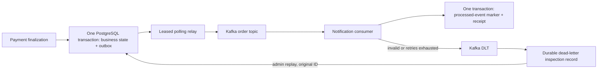

# ADR 006 — transactional outbox and duplicate-safe notifications

Status: accepted for Phase 9. Supersedes direct after-commit publication in Phase 8 and implements ADR 005's deferred reliability work.

## Decision

The final payment transaction updates order/payment/inventory state and synchronously inserts its immutable integration event into `outbox_events`. The event capture method requires an existing transaction and is enabled even when Kafka is disabled. Failure to serialize or persist the event aborts payment finalization. The independent provider intent remains retryable through Phase 7's same-key reconciliation.

The relay claims one eligible row in a short `FOR UPDATE SKIP LOCKED` transaction, commits a random ownership token and 30-second lease, then calls Kafka without holding database locks. It marks PUBLISHED only after the broker acknowledges the send, and only if its token still owns the row. Sends wait at most 12 seconds (producer delivery deadline 10 seconds and metadata wait one second). A failed send reschedules the row with exponential delay starting at one second and capped at 60 seconds. Publication attempts are unbounded: broker downtime never intentionally discards an event.

One scheduler processes up to ten rows per poll, with a one-second delay between polls. Multiple application instances can run relays: row locks prevent duplicate active claims, and expired leases recover crashed claims. Database errors after claim leave a lease that can expire. A process pause past lease expiry or a crash after Kafka acknowledgment but before marking PUBLISHED can produce duplicates. Claim tokens fence database updates, not Kafka sends.

Pending older rows block later rows for the same aggregate. This preserves normal first-publication order for that aggregate while allowing unrelated orders to progress. Event keys remain order UUIDs. This is not a global order guarantee; delayed duplicate sends or explicit historical replays may arrive later than newer events. Changing topic partition count remains an ordering concern.

## Consumer atomicity

`processed_events` has primary key `(consumer_id, event_id)`. The stable logical consumer ID is `order-notifications`, intentionally independent of deployment/group names. The consumer validates the envelope, inserts its marker using `ON CONFLICT DO NOTHING`, and inserts the simulated notification receipt in the same PostgreSQL transaction. Concurrent duplicates wait on the unique key and then do nothing. A receipt failure rolls back the marker; a crash after DB commit but before Kafka offset commit replays without creating another receipt.

V10 backfills markers from Phase 8 receipts without deleting historic duplicate audit rows. Fresh processing creates at most one protected receipt per event. This protects the database notification effect only. A future email/API call must use its own durable delivery intent or provider idempotency; adding a network call inside this transaction would not make it exactly once.

## Failure classification and replay

Transient/unexpected consumer failures get three retries with 1/2/4-second delays, then DLT. Malformed JSON, invalid/unsupported envelopes and database integrity violations go to DLT immediately. DLT publication waits for broker acknowledgment; if it fails, source recovery fails and the record remains retryable instead of being acknowledged as recovered. This uses Spring Kafka's [confirmed dead-letter publication](https://docs.spring.io/spring-kafka/reference/3.3/kafka/annotation-error-handling.html).

The DLT persistence consumer has a separate infinite-retry handler, so database downtime cannot silently discard DLT records or recursively create DLTs. Its PostgreSQL insertion is unique by DLT topic/partition/offset. Separate DLT publications for the same event can still create multiple incident records, which is useful operational history.

Admin replay locks an incident record and atomically inserts a new outbox delivery plus actor/time/reason audit. It preserves original payload bytes, aggregate key, event ID and correlation ID. Repeating the same incident replay request returns the same outbox ID. Malformed/unsupported events are not editable through this API and cannot be blindly replayed. Fix the contract/consumer first; valid event payloads can then be replayed. Replayed historical events do not erase processed-event markers.

## Trade-offs and boundaries

Polling is simple to operate in the current monolith; CDC/Debezium would add infrastructure not needed for this milestone. Leases avoid keeping a DB connection locked across broker I/O, at the cost of possible duplicate sends. Blocking consumer retry preserves local sequence until recovery but can delay other assigned partitions. DLT recovery allows later records to proceed; subsequent replay is historical and not a restoration of original processing order.

Durability assumes PostgreSQL and Kafka storage survive, relays eventually run, and consumers recover within retention or an operator replays retained data. Local Compose remains one plaintext broker with replication factor one, not a production HA guarantee. Order events lost before V10 are not reconstructed: no trustworthy old event identity/payload exists. The outbox closes the new-write dual-write gap, not arbitrary broker data loss or already-expired Kafka records.

## Retention policy

- Never delete PENDING/PUBLISHING outbox rows. Keep PUBLISHED rows at least 30 days, and longer if their incident/replay audit depends on them. No automated cleanup is enabled; review and archive before bounded deletion. The foreign key protects replay-linked rows from accidental deletion.
- Keep processed-event markers indefinitely for this application so old event replay stays safe. Any future pruning requires a formally bounded replay horizon shared with broker retention, archives and operators.
- Order topic retention is seven days; DLT retention is 30 days. Neither is a permanent audit store. Monitor lag daily and investigate before records expire.
- Retain unresolved dead-letter records indefinitely. After confirmed resolution, retain/archive diagnostic payloads and audit for at least 30 days according to the deployment's data policy. Replay-queued is not proof of resolution. No automated purge or payload redaction is implemented.
- These tables grow until an operator introduces reviewed archival/cleanup. Production alert delivery and storage quotas remain later observability/operations work.
