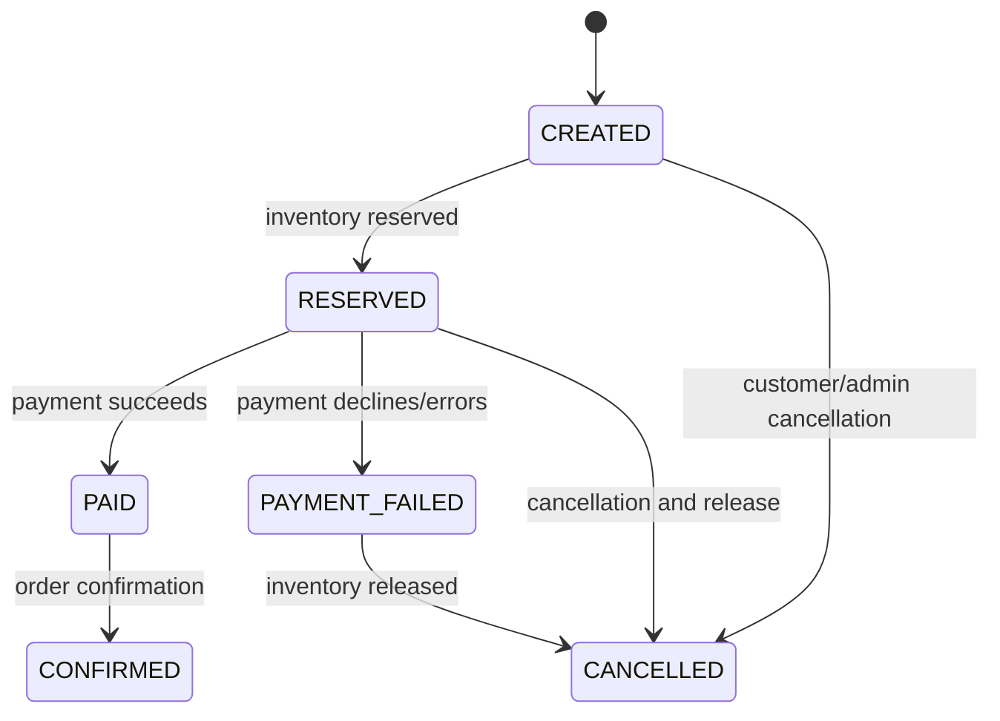

# Order State Machine

Order transitions are domain operations. A caller cannot set an arbitrary status or jump from `CREATED` directly to `CONFIRMED`.

The payment-failure path records the failure before releasing the reservation, preserving an auditable outcome. Later asynchronous phases will make the event and compensation boundaries explicit.
