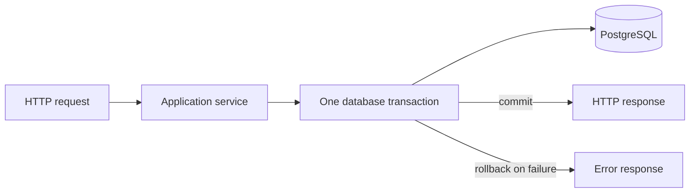

# Transaction Boundaries

Checkout is the important boundary: the active cart lock, authoritative price read, order insert, order-item snapshot inserts, and cart clear commit together. No external payment or messaging call belongs inside this transaction; those are later phases.
