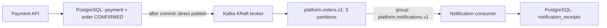

# Phase 8 — Kafka and asynchronous notifications

**Historical Phase 8 design:** Phase 9 supersedes the direct-publication, duplicate-receipt and infinite source-retry behavior below. Current implementation uses the [transactional outbox design](adr/006-transactional-outbox.md) and [DLT runbook](dlt-runbook.md). Events are captured while Kafka is disabled, replay is duplicate-safe, and current tests assert those stronger guarantees. The commands and basic partition/group explanations remain applicable.

## Local topology



Kafka uses the official `apache/kafka:3.9.1` image, a combined broker/controller in KRaft mode, and no ZooKeeper. Compose exposes only loopback port 9092 for host clients and advertises `kafka:19092` for containers on the Compose network. Its named volume retains broker data across container restarts. This single-broker, replication-factor-one, plaintext setup is local-only, not a production topology. Configuration follows the [Apache Kafka single-node example](https://github.com/apache/kafka/blob/3.9.1/docker/examples/docker-compose-files/single-node/plaintext/docker-compose.yml).

```bash
docker compose -f docker-compose.dev.yml up -d postgres redis kafka
KAFKA_ENABLED=true ./mvnw spring-boot:run -pl apps/core-platform
```

Override `KAFKA_BOOTSTRAP_SERVERS` if needed. Messaging is disabled by default; orders confirmed while disabled are not backfilled when it is enabled. Spring creates the owned topic at application startup, with three partitions, one replica and seven-day retention. Do not change partition count casually: it can move an existing key to another partition and break continuity of per-key ordering.

## Event catalog

| Event | Producer / owner | Consumer | Topic / key | Payload version | Retry policy |
| --- | --- | --- | --- | --- | --- |
| OrderConfirmed | Payment completion in core-platform / order module | Notification module | platform.orders.v1 / order UUID | 1 | Producer retries within 10-second delivery deadline; consumer retries indefinitely at one-second intervals; bounded backoff and DLT deferred to Phase 9 |

The JSON envelope uses `event_id`, `event_type`, `version`, `occurred_at`, `correlation_id`, `aggregate_id`, and `payload`. Payload contains `customer_id`, `order_number`, `total`, and `currency`. Correlation ID is currently the order UUID, not an HTTP trace ID. No password, token or card details are sent. Occurrence time is UTC ISO-8601 via the application's Jackson configuration.

Version 1 tolerates extra fields. Missing required fields, mismatched Kafka keys and unsupported versions fail validation; incompatible changes require a versioned contract and coordinated consumer rollout. The first integration event is confirmation only. Inventory and payment remain local synchronous operations; independent inventory/payment event-driven consumers are deliberately deferred instead of publishing unused events.

The in-process application event is created during the final payment transaction. Its transactional listener runs only after commit and serializes the external integration event to Kafka. Rollback publishes nothing; terminal payment replay does not publish another event. Kafka producer idempotence is enabled with `acks=all`, which protects producer retries within Kafka's scope, not business-level delivery across database and broker boundaries.

## API and delivery semantics

No existing HTTP response becomes a promise of future order confirmation. Payment HTTP 200/CONFIRMED means payment, inventory consumption and the order state are committed. Only notification recording happens later. HTTP 202/UNKNOWN remains the payment reconciliation state and produces no confirmation event. There is no email provider and no notification delivery API in this phase; `notification_receipts` is the simulated notification and its audit trail.

Consumer auto-commit is disabled and listener acknowledgment mode is RECORD: offsets advance after successful record processing. A failed database write throws and prevents acknowledgment. The receipt stores event metadata plus topic, partition and offset for debugging. Kafka is not the sole audit store; order history, payments and notification receipts are in PostgreSQL.

- A partition is an ordered append-only log. The order UUID key sends records to the same partition while partitioning configuration stays stable. One producer's sequential sends for that key retain their sequence. There is no total order across partitions and no implied causal ordering between concurrent independent producers.
- A consumer group divides partitions among its members. With three partitions, at most three consumers in this group can actively process records in parallel. Other groups independently consume the same records using their own offsets.
- An offset identifies a position within one partition, not a global event number. Committed group offsets are restart checkpoints. Rebalancing transfers partition assignments when membership changes; in-flight work can be replayed around that transfer.
- A crash between receipt insertion and offset commit can create another receipt for the same event. The replay integration test deliberately demonstrates this. Receipt event IDs are indexed, **not unique**; this phase does not claim consumer idempotency or exactly-once side effects.
- At-most-once commits before processing and can lose work; at-least-once commits after processing and can repeat work. Kafka exactly-once processing does not automatically make an external PostgreSQL/email side effect exactly once.

## Known failure windows

**Direct database → Kafka publication still has a dual-write gap.** Process death after commit but before send, broker outage past the delivery deadline, or disabled messaging can leave a CONFIRMED order without an event. Publication errors log event/order IDs and do not turn a committed payment into an HTTP failure. Serialization/metadata lookup can briefly block the after-commit callback (producer max-block is one second); the send acknowledgment itself is asynchronous. There is no durable publication backlog, automatic backfill, or retry-on-payment-replay in Phase 8.

Malformed records and persistent database failures retry without silently skipping the record. A poison record can block progress and increase lag; with the current single listener it can also delay other assigned partitions. Stop and investigate rather than blindly resetting offsets. Bounded retry, failure classification, DLT, safe operational replay and alerting belong to Phase 9. Seven-day broker retention is not indefinite recovery storage. Notification receipt cleanup is also not implemented yet.

The next reliability milestone must atomically persist an outbox record with the order change, relay it to Kafka, and deduplicate consumers. Until then this is an educational/local asynchronous integration, not a reliable delivery guarantee.

## Tests and inspection

With Docker, use the same workflow tests with Kafka and PostgreSQL Testcontainers:

```bash
./mvnw -B -ntp -pl apps/core-platform \
  -Dtest=KafkaIntegrationTest,OrderMessagingTest -Dphase8.testcontainers=true verify
```

Without Docker, the default Kafka test mode starts a real embedded KRaft broker. Supply a disposable PostgreSQL database (migrations and fixtures are committed):

```bash
./mvnw -B -ntp -pl apps/core-platform \
  -Dtest=KafkaIntegrationTest,OrderMessagingTest \
  -Dphase6.jdbc-url=jdbc:postgresql://127.0.0.1:55432/phase7_verify_20260921 \
  -Dphase6.db-user=platform verify
```

Tests cover confirmed-order production and asynchronous consumption, rollback/no publication, known payment failure/no confirmation, per-key order, consumer restart from committed offsets, explicit replay showing duplicate receipts, and database failure without premature offset advancement. Unit tests cover JSON compatibility, invalid envelope rejection, and synchronous/asynchronous producer errors. See [Spring Kafka testing](https://docs.spring.io/spring-kafka/reference/3.3/testing.html) and [Testcontainers Kafka](https://java.testcontainers.org/modules/kafka/) for the two broker runtimes.

Inspect topic partitions and consumer lag locally:

```bash
docker compose -f docker-compose.dev.yml exec kafka /opt/kafka/bin/kafka-topics.sh \
  --bootstrap-server kafka:19092 --describe --topic platform.orders.v1
docker compose -f docker-compose.dev.yml exec kafka /opt/kafka/bin/kafka-consumer-groups.sh \
  --bootstrap-server kafka:19092 --describe --group platform.notifications.v1
```

Inspect receipts using `SELECT event_id, order_id, kafka_partition, kafka_offset, recorded_at FROM notification_receipts ORDER BY recorded_at DESC;` in PostgreSQL. A receipt means only that the simulated notification was recorded, not that a customer received an email.
