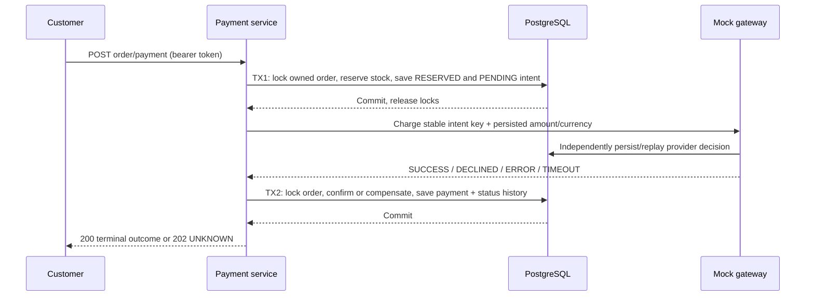

# Phase 7 — synchronous simulated payments

## Use

1. Create a product and set its available stock via the existing admin inventory API.
2. As a customer, add cart items and check out with `POST /api/orders` and an `Idempotency-Key`. Checkout still returns a CREATED order; its replay response remains unchanged after payment.
3. Call `POST /api/orders/{orderNumber}/payment` with the customer's bearer token. There is no payment body, caller-supplied amount, or payment key. Ownership comes from the authenticated subject, and the stable key is `order:<order UUID>`.
4. Read current order status through the existing order lookup endpoint. Repeat the payment request to replay a terminal result or reconcile an unknown result.

Default mock outcome is SUCCESS. Start with `PAYMENT_MOCK_OUTCOME=DECLINED`, `TIMEOUT`, or `ERROR` to exercise another scenario. Configuration applies only to unseen provider keys; existing provider decisions cannot change. No real money or card data is involved.

## Sequence



The service refuses invocation inside an existing transaction. Gateway calls run outside both workflow transactions. The mock's independent ledger stands in for provider-side durability; it is not a real network provider. PaymentGateway is the adapter boundary, and the selected implementation supplies the payment strategy. Kafka, domain-event publication, circuit breakers, and real provider adapters are intentionally deferred.

## Failure matrix

| Gateway result | Payment | Order | Reservation | Recovery |
| --- | --- | --- | --- | --- |
| SUCCESS | SUCCESS | RESERVED → PAID → CONFIRMED | CONFIRMED; reserved stock consumed | Replay saved result |
| DECLINED | DECLINED with reason | RESERVED → PAYMENT_FAILED → CANCELLED | RELEASED; stock restored | Terminal; new checkout required |
| ERROR (mock known pre-charge failure) | ERROR with reason | RESERVED → PAYMENT_FAILED → CANCELLED | RELEASED; stock restored | Terminal; new checkout required |
| TIMEOUT / unexpected gateway exception | UNKNOWN | RESERVED | ACTIVE; stock retained | Repeat same intent, never use a new payment key |

TIMEOUT deliberately simulates a provider that committed SUCCESS but lost its first response. The second same-key request finds the durable decision, even after adapter/application restart. A real provider could remain unknown; integration would require lookup/webhook/manual reconciliation before releasing stock. “Retry every error” with a fresh key is unsafe because a timeout may already have charged the customer.

Insufficient inventory rolls back every reservation and the intent together: no gateway call occurs and the order stays CREATED. Retrying after stock replenishment is safe. If the process dies after TX1, repeat the request to continue its PENDING intent. If the provider commits but TX2 fails, repeat the same request to recover the saved provider result. A late timeout cannot overwrite a terminal outcome.

## Persistence and scope

- One payment attempt/intent per order; retries reconcile that intent, rather than creating new charges. Persisted fields include amount/currency, stable key, outcome/reason, unique gateway reference, and timestamps. This phase does not store every HTTP retry as a separate audit record.
- A composite foreign key ties the payment amount/currency to the order; unique order and provider keys prevent duplicate payments. Order transitions use the existing domain state machine and append to `order_status_history` in the same transaction.
- Product UUIDs are now included in immutable checkout snapshots. Mixed-currency carts and disabled products are rejected before creating an order.
- V8 leaves old order items without product UUIDs. Such orders cannot be paid automatically; a new checkout is required. Guessing identity from mutable SKUs would risk reserving the wrong product. Existing order histories begin with the status observed during migration, not reconstructed historical transitions.
- Reservation expiry is still metadata, with no automatic cleanup worker. PENDING/UNKNOWN reservations must not be released based solely on age. Reconciliation is request-driven in this phase; abandoned intents require operational follow-up. There is no cancellation/refund endpoint or real provider integration.
- This phase does not claim production readiness or completion of later roadmap phases.

## Verification

With Docker available, the payment tests automatically provision PostgreSQL:

```bash
./mvnw -B -ntp -pl apps/core-platform -Dtest=PaymentIntegrationTest,OrderTest verify
```

For an already running disposable database, append `-Dphase6.jdbc-url=jdbc:postgresql://127.0.0.1:55432/phase6 -Dphase6.db-user=platform -Dphase6.db-password=...`. The property name is shared with the prior phase's test setup. Run these only against a disposable database: migrations and unique fixtures are committed.
